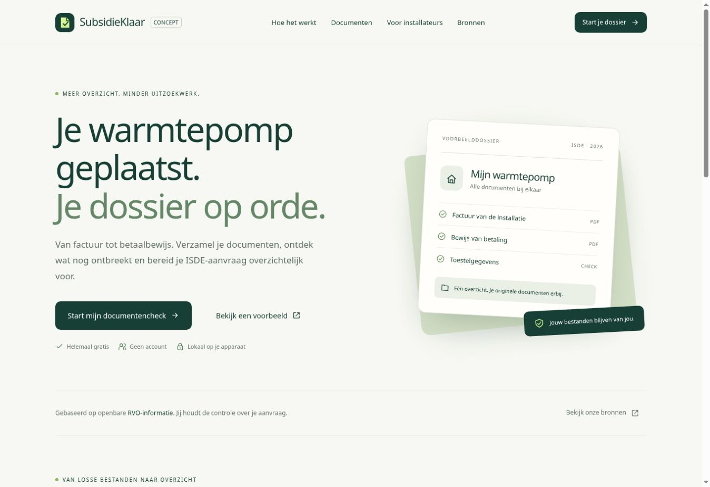

# SubsidieKlaar

**Werkend concept v0.1 — werknaam.** Een gratis documentenwerkbank voor Nederlandse eigenaar-bewoners met een warmtepomp. Vier stappen leiden van een situatiecheck en installatiegegevens naar originele bijlagen en een downloadbaar voorbereidingspakket.

De tool draait lokaal in de browser. Geen account, betaalde API, licentiesleutel, externe fontdienst of documentupload nodig. Het concept is geen subsidiebesluit of inhoudelijke controle van bewijsstukken.

## Meteen bekijken

Download **[concept/SubsidieKlaar-concept.html](concept/SubsidieKlaar-concept.html)** en open het bestand in een moderne browser. Alles wat de tool nodig heeft is in dat ene bestand opgenomen. Kies **Bekijk een voorbeeld** om de volledige flow en echte PDF/ZIP-downloads te proberen. Voorbeeldgegevens en voorbeeldbijlagen zijn expliciet fictief.

De originele ontwikkelversie begint bij `index.html`. Onder **Backoffice concept** staan de werkelijke lokale gebeurtenistellingen van die browser, productstatus en officiële bronnen. De backoffice is in dit concept openbaar en bevat geen servergegevens, login of centrale statistieken.



Zie het [testverslag](docs/QA.md) voor de 20 geslaagde tests, browsercontroles en bekende grenzen.

## Wat werkt

- Vier stappen: situatie, gegevens, documenten en overzicht.
- Afzonderlijke signalering van ontbrekende informatie, eigen bevestiging, voorbereiding, uitzonderingen en situaties buiten de huidige scope.
- Meldcode met eigen bevestiging, of productbeschrijving plus technische documentatie.
- Meerdere betalingen en een afzonderlijke route voor een door de leverancier als betaald gemarkeerde factuur bij winkelbetaling.
- Indicatie van 24 kalendermaanden na daadwerkelijke installatie, inclusief schrikkeldagen.
- PDF-overzicht en ZIP met ongewijzigde originele bijlagen, HTML-overzicht, project-JSON en bestandenindex.
- Project-JSON openen en optioneel lokaal bewaren van invulgegevens. Originele bestanden blijven alleen in het geheugen en moeten na heropenen opnieuw worden toegevoegd.
- Veilige bestandsnamen, controle op bestandssignaturen, type- en groottelimieten, ontsnappen van gebruikersinvoer en begrensde JSON-import.
- Lokale analytics voor bezoeken, gestarte checks, bekeken overzichten en gemaakte downloads, zonder namen, adressen of documentinhoud.

## Lokale ontwikkeling

Node.js 20 of nieuwer is voldoende. Er zijn geen npm-installatiestappen.

```sh
npm run dev
```

Open de URL van de lokale server (standaard poort 5173). De server begrijpt ook `--port` voor een beheerde preview.

```sh
npm test
npm run build
```

`build` maakt het zelfstandige HTML-bestand opnieuw. Dit bestand is bewust onderdeel van de repository, zodat het concept rechtstreeks kan worden gedownload.

## Projectindeling

| Bestand | Doel |
| --- | --- |
| `index.html` | Startpunt van de ontwikkelversie |
| `assets/app.js` | Schermen, lokale invoer, bestandsselectie, bewaren en lokale analytics |
| `assets/core.js` | Afhankelijkheidsvrije, deterministische aanwezigheid- en scopechecks |
| `assets/export.js` | PDF, HTML, ZIP, originele bijlagen en projectuitvoer |
| `assets/style.css` | Responsieve huisstijl en schermopmaak |
| `vendor/` | Lokale PDF/ZIP-bibliotheken, lettertype en licentienotities |
| `tests/` | Betekenisvolle controles van regels, import en exportintegriteit |
| `docs/RVO-sources.md` | Geverifieerde RVO-bronnen en implementatiegrenzen |
| `docs/NAME-OPTIONS.md` | Naamopties en de waargenomen SIDN-status |
| `docs/PLAN.md` | Vervolg van concept naar productie |

## Grenzen van dit concept

De bestanden worden nog niet met OCR of PDF-tekstextractie gelezen. Het systeem controleert aanwezigheid en de bevestigingen van de gebruiker. Na relevante wijzigingen vervallen eerdere bevestigingen. RVO voert de inhoudelijke beoordeling uit.

De eerste scope is de gewone eigenaar-bewonerroute voor warmtepompen. Andere maatregelen en routes worden niet als afgedekt gepresenteerd. Bronnen zijn handmatig gecontroleerd op **13 november 2026**; installaties vanaf 2027 krijgen een controlesignaal omdat de 2027-wijzigingen op die datum nog voorgenomen waren. Er wordt geen subsidiebedrag berekend.

Het ingebedde PDF-lettertype ondersteunt veel Europese tekens. Als een ingevoerd teken niet wordt ondersteund, wordt geen onvolledig PDF-bestand geleverd: het ZIP-pakket bevat dan wel een volledig Unicode-HTML-overzicht met uitleg. Afdrukken vanuit de browser is eveneens beschikbaar.

Het concept heeft `noindex` en een blokkerende `robots.txt`. Dit voorkomt geen toegang; het voorkomt dat we een onvoltooide productversie bewust laten indexeren. Er is nog geen definitieve domeinnaam en er is geen claim dat Hostinger al is aangesloten.

## Hostinger en GitHub

De repository gebruikt `main`, zoals afgesproken. Voor een custom PHP/HTML-website kan de bronversie met `index.html`, `assets/` en `vendor/` worden geplaatst. Het zelfstandige conceptbestand kan ook als `index.html` dienen. Domein, hostingplan, documentroot en automatische deploy worden na de conceptbeoordeling aangesloten en gecontroleerd.

De productie-backoffice krijgt echte authenticatie, beperkte beheerrechten, centrale aggregaten, back-ups en een beveiligde integratielaag voor ChatGPT. Gebruik dit openbare backofficeconcept niet voor servergeheimen of klantbestanden.

## Licenties en kosten

De benodigde distributiebestanden zijn lokaal opgenomen. Zie [vendor/NOTICE.md](vendor/NOTICE.md) en de afzonderlijke licentieteksten. De gekozen afhankelijkheden en het lettertype staan commercieel gebruik toe onder hun meegeleverde voorwaarden. Het publieke product doet geen betaalde AI-aanroepen. Domein en hosting zijn de infrastructuur die de eigenaar zelf kiest; betaalverwerking heeft later mogelijk transactiekosten.

De licenties van afhankelijkheden gelden voor die afhankelijkheden. Deze repository kent daarmee niet automatisch een algemene opensourcelicentie toe aan de eigen applicatiecode.
